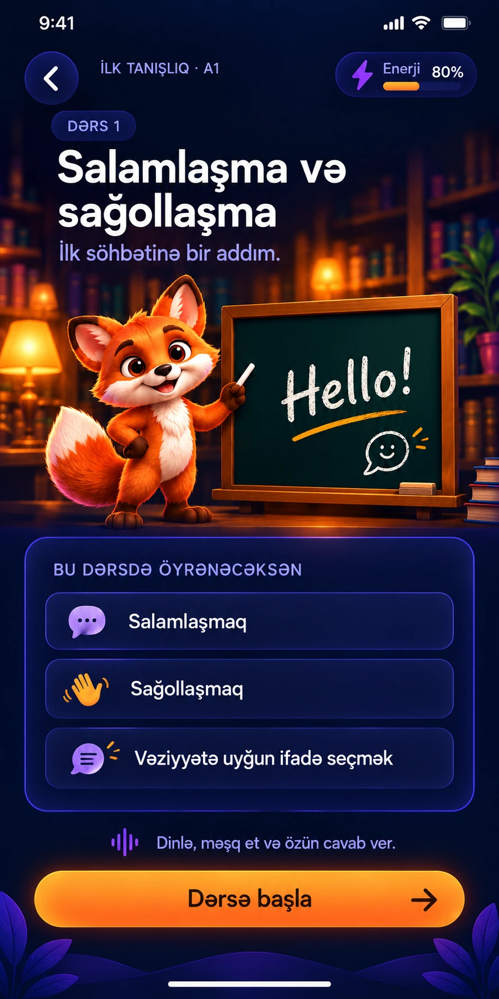
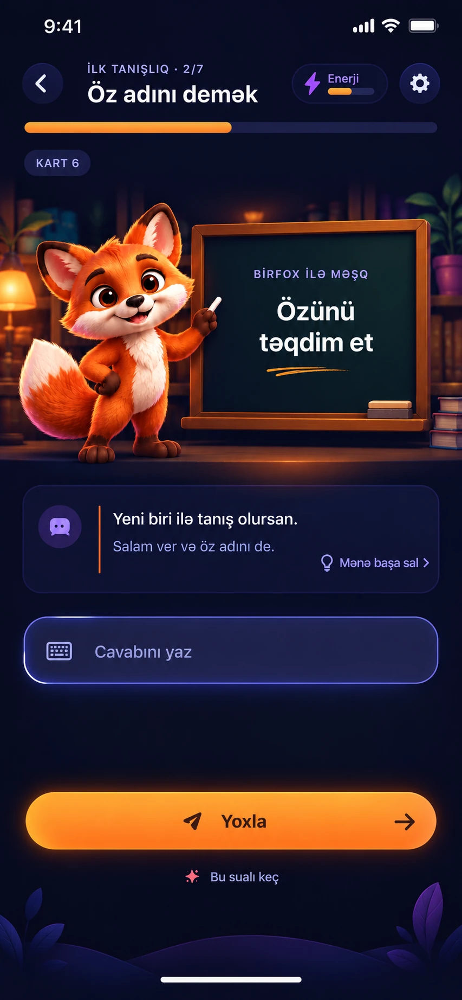
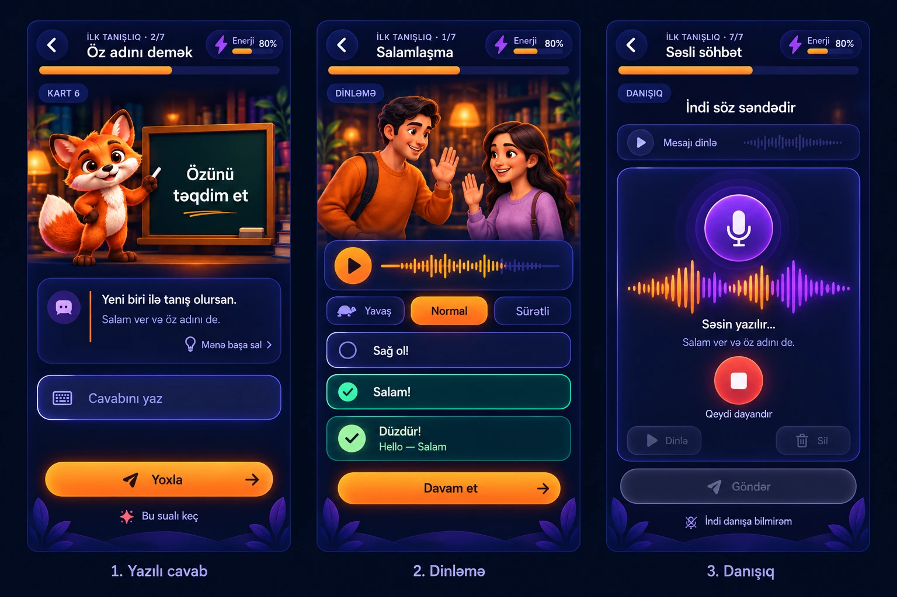
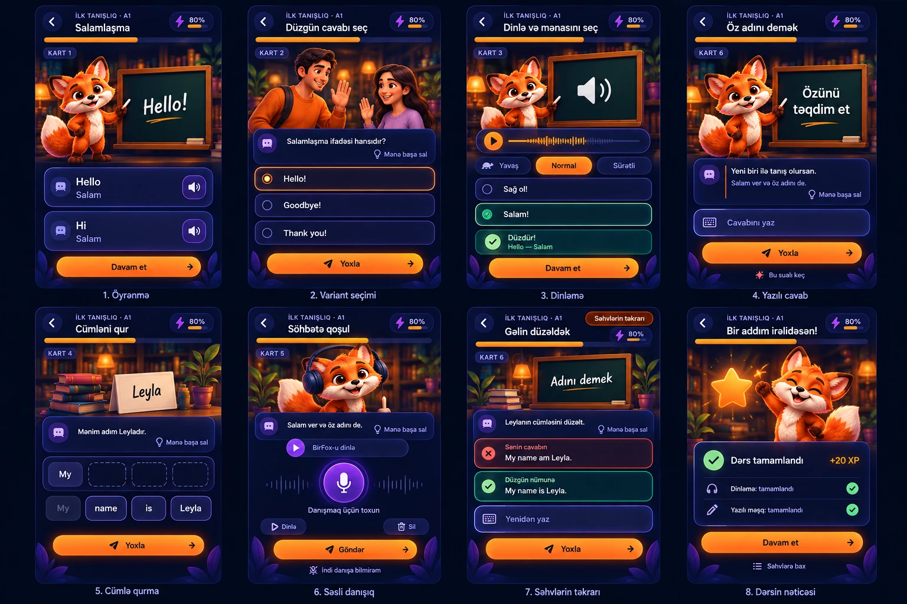

# BirTalk — təsdiqlənmiş dərs dizaynları

21 oktyabr 2026. Bunlar dizayn istinadlarıdır, işləyən tətbiq ekranları deyil. Bu dəyişiklik yalnız `docs/design/approved-20261021/` qovluğunu əlavə edir; tətbiqin mənbə kodunu dəyişmir.

## Son təsdiqlənmiş istiqamət

Tünd gecə göyü fon, isti işıqlı 3D səhnələr, yumru kartlar, incə bənövşəyi işıqlı kənarlar, aktiv elementlərdə narıncı vurğu. Düzgün cavab nanə yaşılı ilə göstərilir. Bütün kənarlarda güclü neon və davamlı yanıb-sönmə nəzərdə tutulmur.

### 1. Dərsin giriş ekranı

Dərs mövzusu, öyrəniləcək bacarıqlar, mövzuya uyğun səhnə və “Dərsə başla”. Bu düymə əvvəlcə öyrənmə kartını açır; istifadəçiyə öyrədilməmiş sual dərhal verilmir.

### 2. Yazılı cavabın əsas istinadı

Sual, cavab sahəsi və alt düymə aydın ayrılır. “Mənə başa sal” yalnız izaha ehtiyac olan tapşırıqda sual kartının içində kiçik ikinci dərəcəli düymədir. Hər kartda və hər ekranda göstərilməməlidir.

### 3. Yazılı, dinləmə və danışığın son nümunəsi

- Yazılı: lövhəli səhnə, sual kartı, cavab sahəsi, “Yoxla”.
- Dinləmə: uyğun insan/məkan səhnəsi, səs idarəsi, yavaş/normal/sürətli seçimləri, cavab variantları. Məna soruşulursa tərcümə cavab yoxlanana qədər açılmır.
- Danışıq: əsas vizual mikrofon və həqiqi səs gücünə uyğun dalğadır. Maskot əsas vizual deyil. Səssizlikdə dalğa sakitləşir. Bu statik şəkil animasiyanın işlədiyini təsdiqləmir.

Danışıq axını: mesajı dinlə → qeydə başla → qeydi dayandır → dinlə/sil/yenidən yaz → göndər. Qeyd davam edərkən göndərmə aktiv olmur. Dinləmə dalğası yalnız səslənən audio ilə uyğun olduqda işlədilməlidir; təxmini dalğa və saxta vaxt/səs balı göstərilməsin.

## Dərsin axını

| Mərhələ | Görünüş | Qeyd |
| --- | --- | --- |
| Giriş | Mövzu və bacarıqlar | Dərsə başla |
| Öyrənmə | İfadə, məna, ingiliscə audio | Hello / Hi kimi ifadələr əvvəl öyrədilir |
| Variant seçimi | Sual və variantlar | Seçim ayrıca “Yoxla” ilə təsdiqlənir |
| Dinləmə | Audio və uyğun cavab | Səs sürətləri, məna gizliliyi |
| Yazılı cavab | Sual və mətn sahəsi | Klaviaturada cavab sahəsi görünən qalır |
| Cümlə qurma | Sözlər və cümlə sahəsi | Eyni yumru kart üslubu |
| Danışıq | Mikrofon, həqiqi səs dalğası | Maskot yerinə audio idarəsi |
| Səhvlərin təkrarı | Öz cavabın, uyğun nümunə, izah | Eyni suala aid məlumatlar birlikdə |
| Nəticə | Yenidən dizayn ediləcək | Əvvəlki 8-ci ekran təsdiqlənməyib |

Hər dərs eyni sayda kartı və bütün növləri məcburən istifadə etməməlidir; mövcud məzmunun ardıcıllığı qorunur.

## Əvvəlki ümumi lövhə — yalnız istinad

Bu lövhənin ilk 7 görünüşünün ümumi istiqaməti bəyənilib. **8-ci nəticə ekranı rədd edilib.** Danışıqda fox və hər yerdə izah düyməsi kimi köhnə detalları tətbiq etməyin; yuxarıdakı son 3-ekran nümunəsi və istifadə qaydası üstündür.

## Tətbiqə keçirərkən

Əvvəl bir yazılı ekranı hazırlayın, telefonda adi və klaviaturalı görünüşü təsdiqləyin, sonra digər görünüşlərə eyni komponentləri keçirin. Nümunə şəkli bütöv fon kimi yerləşdirməyin: mətn, düymə, input, enerji və kartlar native komponent olmalıdır. Səhnə ayrıca boş lövhəli assetdən qurulmalıdır.

- Əsas məzmun adi telefon ölçüsündə sığmalıdır; uzun mətn və böyük əlçatanlıq şriftində kəsmək əvəzinə təhlükəsiz sürüşdürmə saxlanmalıdır.
- Nəticə bildirişi alt düymənin arxasında qalmamalıdır.
- Klaviatura açılanda dekorativ səhnə yığcamlaşmalıdır; sual, cavab sahəsi və əsas düymə görünməlidir.
- “Bu sualı keç” aydın etiketi istifadə olunur; qiymətləndirmə qaydasını bu dizayn işi dəyişmir.
- Mənası bilinməyən sözə tərcümə uydurulmur; Azərbaycan dilindəki mətn avtomatik səsləndirilmir.
- Səhv izahında əvvəlki sual/cavab və yeni təkrar tapşırığı qarışdırılmır.
- Şəkildəki 80% enerji və digər rəqəmlər nümunədir; tətbiq həqiqi məlumatı göstərməlidir.
- Ana səhifə, bölmə xəritəsi, XP/enerji və dərs açılma qaydaları ayrıca icazəsiz dəyişdirilməməlidir. 50% açılma təklifi hələ tətbiq edilmir.

## Hazırkı texniki vəziyyət

İstifadəçinin son göndərdiyi `Lingua-app-master (7)(2).zip` köhnə master mənbələridir: hazırkı 7-dərs `PacketLesson.tsx` və kompüterdəki son UI dəyişiklikləri yoxdur. Onun əsasında cari işləyən tətbiqi əvəz etməyin. Son lokal `src`, `assets`, `package.json`, `AGENTS.md` alınmadan bu istinadları tətbiqə keçirilmiş hesab etməyin.

Əvvəlki yarımçıq GitHub blob-ları hazır versiya deyil və bu budağa daxil edilmir. Onlarda tamamlanmamış şəkil istinadı və yoxlanmamış kod var.

Vizual yoxlama: dörd WebP faylı açılır və ölçüləri manifestdədir. Mənbə kodu dəyişmədiyi üçün typecheck/lint nəticəsi iddia edilmir. Native iPhone görünüşü, klaviatura, qeyd və playback dalğası implementasiyadan sonra yoxlanmalıdır.

## Mənşə və təkrar istifadə

Nümunələr bu söhbətdə daxili şəkil yaratma aləti ilə istifadəçinin seçdiyi BirTalk üslubu əsasında hazırlanıb. WebP versiyaları yalnız ölçü/format optimallaşdırmasıdır. Yenidən şəkil yaratmadan əvvəl bu faylları istinad kimi istifadə edin. Sosial media postları bu dizayn paketinə daxil deyil.
